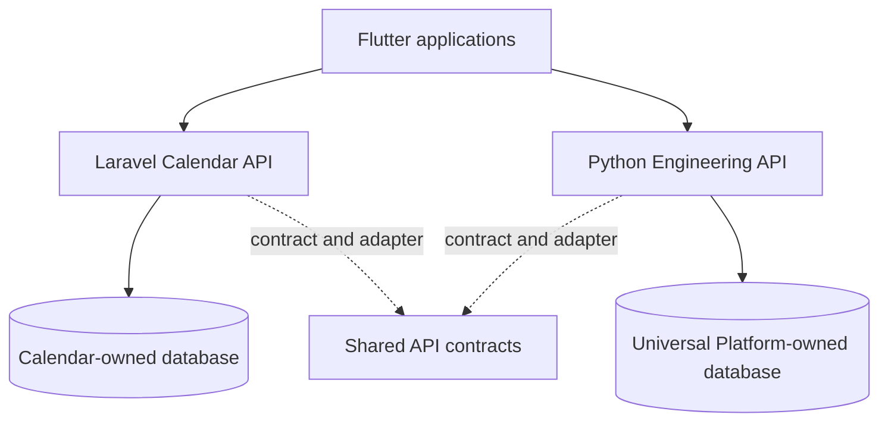

# Shared Hybrid Backend Architecture

## Logical view

## Component ownership

| Component | Owner | Responsibility |
|---|---|---|
| Flutter client | Calendar/application layer | UI, typed clients, endpoint configuration |
| Laravel API | Calendar repository | Identity integration, organization, roster, shift transactions |
| Python API | Universal Platform | Engineering, CAD, physics, calculations, local workspaces |
| Shared contracts | Shared documentation/specification | Versioning, schemas, error conventions, correlation |
| Persistence | Each domain | Own migrations, transactions, backups, retention |

## Deployment
Start local-first on existing hardware. Each service has an independent lifecycle and health check. Do not assume fixed ports; discover or configure endpoints at runtime. Do not expose loopback services to LAN/Internet by default.

## Boundaries
- Shared contract does not imply shared database.
- Calendar credentials must not automatically authorize Engineering operations.
- Python local bearer tokens must not be treated as Calendar identity.
- Cross-domain calls require an explicit adapter, least-privilege authorization, bounded payloads, and audit evidence.
- Avoid introducing a gateway process until a concrete use case requires it.

## Evolution gate
Evaluate FastAPI, async I/O, worker separation, PostgreSQL, or a gateway only when measured concurrency, operational, or compatibility requirements justify the additional dependency and maintenance.
